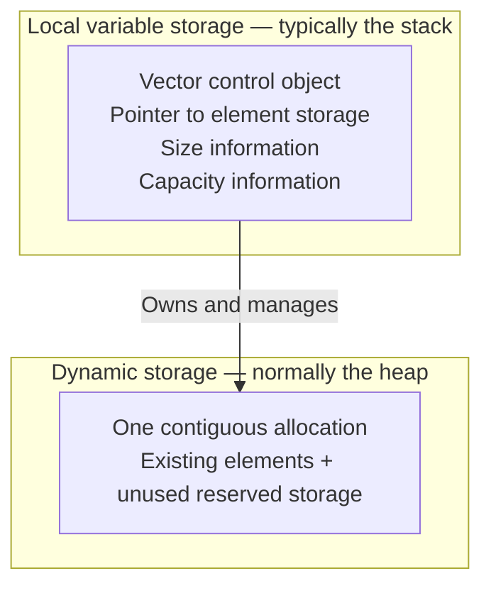
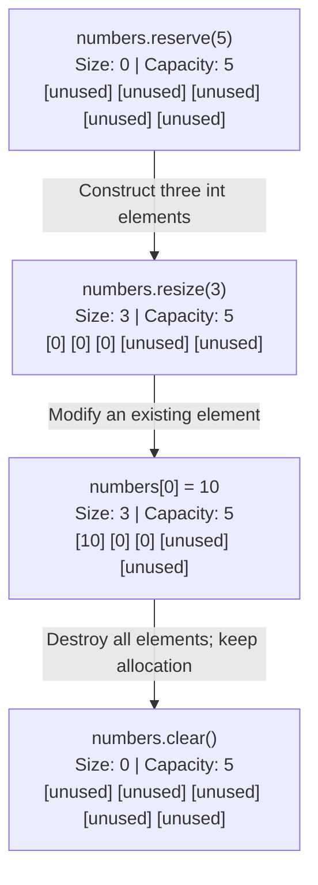
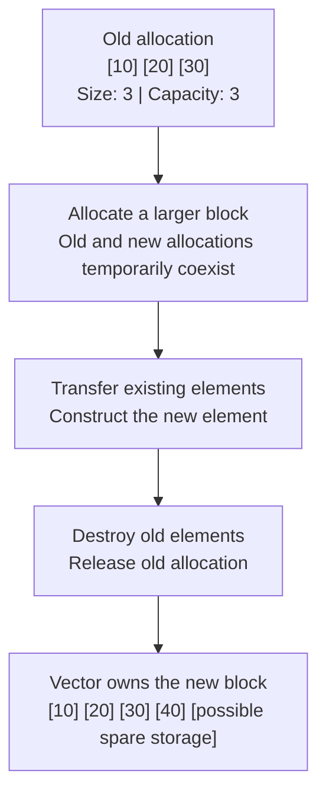
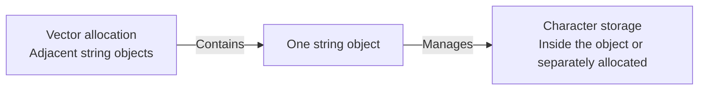
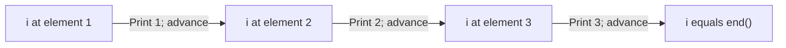

# cpp-012-vectors

## 📦 What Is a Vector?

A **`std::vector`** stores elements in a contiguous sequence and can grow as you add elements. Like an array, its indexes start at `0`.

This complete example adds three strings and reads the second one:

```cpp
#include <iostream>
#include <string>
#include <vector>

int main() {
    std::vector<std::string> meVector;

    meVector.push_back("Hi");
    meVector.push_back("Hi again");
    meVector.push_back("baby");

    std::cout << meVector[1] << '\n';
}
```

**Expected output:**

```text
Hi again
```

`push_back()` adds an element at the end. After these calls:

| Index | Element |
|---|---|
| `0` | `"Hi"` |
| `1` | `"Hi again"` |
| `2` | `"baby"` |

> ⚠️ **Valid indexes depend on size.**
>
> With three elements, valid indexes are `0`, `1`, and `2`. Reading `meVector[3]` causes undefined behavior because that element does not exist.
>
> `meVector.at(3)` checks the index and throws `std::out_of_range` instead.

The following snippets belong inside `main()`, with the appropriate headers included as above.

---

## 💾 Size and Capacity

**Size** counts existing elements. **Capacity** describes how many elements fit in the vector's current storage before reallocation becomes necessary.

```cpp
std::vector<int> numbers;

numbers.reserve(5);
numbers.push_back(10);
numbers.push_back(20);

std::cout << numbers.size() << '\n';      // 2
std::cout << numbers.capacity() << '\n';  // at least 5
```

There are two usable elements and storage for at least five. The exact capacity is chosen by the implementation; `reserve(5)` does not require it to be exactly `5`.

| Method | Meaning |
|---|---|
| `size()` | Returns the number of existing elements |
| `capacity()` | Returns how many elements fit in the current allocation |
| `reserve(n)` | Requests capacity for at least `n` elements without changing size |
| `resize(n)` | Changes the number of elements to `n` |
| `clear()` | Removes all elements while retaining capacity |

The relationship is always:

```cpp
numbers.size() <= numbers.capacity()
```

### 🏗️ `reserve()` Makes Room

```cpp
std::vector<int> numbers;
numbers.reserve(5);
```

The vector now has storage for at least five integers, but it still contains **zero elements**. `reserve()` does not initialize five values or make indexes `0` through `4` valid.

Calling `reserve()` with a value less than or equal to the current capacity does nothing; it does not shrink the allocation.

> ⚠️ **Capacity does not make an index valid.**
>
> After this `reserve(5)`, reading or writing `numbers[0]` is invalid because `size()` is still `0`. Create elements using `push_back()` or `resize()` first.

### 🧱 `resize()` Creates or Removes Elements

```cpp
std::vector<int> numbers;
numbers.reserve(5);

numbers.resize(3);
// Contains: {0, 0, 0}

numbers.resize(5, 42);
// Contains: {0, 0, 0, 42, 42}

numbers.resize(2);
// Contains: {0, 0}
```

With the default allocator, new `int` elements added by `resize(n)` are initialized to `0`. With `resize(n, value)`, only the newly added elements receive `value`.

- 📦 **Growing:** Constructs additional elements. If the requested size exceeds capacity, the vector reallocates.

- ✂️ **Shrinking:** Destroys elements from the end and retains capacity.

### 🧹 `clear()` Removes Every Element

```cpp
numbers.clear();

std::cout << numbers.size() << '\n';  // 0
```

`clear()` destroys all elements while retaining the allocated storage. You can refill the vector without reallocating as long as you stay within its capacity.

It does not promise to overwrite the former element bytes with zeros.

---

## 🧠 What Happens in Memory?

A vector has a small **control object** and separately allocated **element storage**. For a local vector, the control object typically lives on the stack; with the default allocator, element storage normally comes from the heap.

A useful model is a pointer plus information describing size and capacity. The exact internal fields and control-object size are implementation details.



A global vector's control object has static storage duration. Making the vector global does not make its element allocation part of that object.

### 📐 Follow Each Operation

For this diagram, assume `reserve(5)` produces capacity exactly `5`. Actual implementations may allocate more.

```cpp
std::vector<int> numbers;

numbers.reserve(5);
numbers.resize(3);
numbers[0] = 10;
numbers.clear();
```



Each box represents storage for one `int`. An **unused** box belongs to the allocation but is outside the vector's existing elements; you cannot access it through `operator[]`.

If `sizeof(int) == 4` and capacity is exactly `5`:

```text
Size 3:      3 × 4 = 12 bytes occupied by existing int elements
Capacity 5:  5 × 4 = 20 bytes of element storage
```

After `clear()`, the vector still retains those 20 bytes of element storage. These calculations exclude the vector control object and allocator bookkeeping.

### 🔄 When Capacity Is Exhausted

Suppose a vector contains `{10, 20, 30}` and its capacity is exactly `3`. Adding `40` requires a larger contiguous allocation.



This is a conceptual sequence; the precise construction order can vary. The implementation also chooses the growth factor, so capacity is not guaranteed to double.

> ⚠️ **Reallocation changes element addresses.**
>
> Pointers, references, and iterators into the previous allocation become invalid. The temporary need for both allocations can also increase peak memory usage on a microcontroller.

For embedded code, requesting a known capacity during initialization can keep subsequent additions within one allocation. The initial allocation can still fail, and the allocator must find a sufficiently large contiguous block.

### 🔤 Memory Used by `vector<string>`

In `std::vector<std::string>`, the **string objects** are contiguous. Their character data may live inside each object or in separately allocated storage.



Consequently, `capacity() * sizeof(std::string)` does not include possible separate character allocations. Reserving vector capacity does not reserve character capacity inside each string.

---

## 👉 Iterators: Visiting Elements by Position

An **iterator** represents a position in a container. You can dereference a vector iterator to access an element and increment it to advance.

```cpp
std::vector<int> it = {1, 2, 3};

auto i = it.begin();

std::cout << *i++ << '\n';
std::cout << *i++ << '\n';
std::cout << *i++ << '\n';
```

**Expected output:**

```text
1
2
3
```

Here, `it` is the vector's name and `i` is the iterator. `auto` deduces the iterator type, which is `std::vector<int>::iterator` for this expression.

The expression `*i++` is parsed as:

```cpp
*(i++)
```

Postfix increment produces the iterator's previous position and advances `i`. Dereferencing the previous position accesses the element that gets printed.



After the third statement, `i` equals `it.end()`. That is a valid stopping position, but it does not refer to an element.

> ⚠️ **Never dereference `end()`.**
>
> A fourth `std::cout << *i++` would be invalid.

A loop makes the stopping condition explicit:

```cpp
for (auto i = it.begin(); i != it.end(); ++i) {
    std::cout << *i << '\n';
}
```

- **`begin()`** returns the first element's position, or equals `end()` when empty.

- **`end()`** identifies the position just past the last element.

- **`*i`** accesses the current element.

- **`++i`** advances to the next position.

Reallocation invalidates these iterators. `clear()` also invalidates iterators to the removed elements, even though the allocation remains.

---

## 🧪 Interview Q&A

**Q1:** After `reserve(100)`, how many elements does an initially empty vector contain?

**Q2:** Does `resize(3)` release storage when capacity is currently `100`?

**Q3:** Why can `push_back()` invalidate an iterator?

**Q4:** Does `clear()` return the vector's element allocation to the heap?

**Q5:** After printing all three elements using `*i++`, where does `i` point?

> [!answer]- 📋 Answers
>
> **A1:** Zero. `reserve()` requests storage without adding elements.
>
> **A2:** No. It changes the element count to three and retains capacity.
>
> **A3:** If growth requires reallocation, the elements move to another allocation. Iterators into the previous allocation become invalid.
>
> **A4:** No. It destroys the elements and retains the allocation. Destroying the vector releases its allocation through the allocator. Removed elements may themselves own resources that their destructors release.
>
> **A5:** It equals `end()`, the position just past the last element. You must not dereference it.

## 🔨 Hands-On Practice

1. 🔎 **Observe size and capacity separately.**

    Start with an empty vector, call `reserve(8)`, and print both values.

    ✅ Expect size `0` and capacity at least `8`.

2. 🧱 **Create and remove elements.**

    Call `resize(3, 7)` and print the elements. Then call `resize(1)`.

    ✅ Expect `{7, 7, 7}`, followed by `{7}`. Capacity remains unchanged during the shrink.

3. 🧹 **Reuse the allocation.**

    Record capacity, call `clear()`, and add `99` with `push_back()`.

    ✅ Expect size `1`, element `99`, and the same capacity.

4. 👉 **Trace an iterator.**

    Use `{1, 2, 3}` and print each element with the iterator loop above. Predict where the iterator is before and after each increment.

    ✅ Every dereference happens while the iterator differs from `end()`.

### 📋 Quick Reference

| Expression | Effect |
|---|---|
| `v.push_back(value)` | Adds an element at the end; may reallocate |
| `v[index]` | Accesses an existing element without checking bounds |
| `v.at(index)` | Accesses an element with bounds checking |
| `v.size()` | Counts existing elements |
| `v.capacity()` | Reports available element storage |
| `v.reserve(n)` | Requests capacity of at least `n`; preserves size |
| `v.resize(n)` | Adds or removes elements to reach size `n` |
| `v.resize(n, value)` | Uses `value` for newly added elements |
| `v.clear()` | Removes all elements; retains capacity |
| `v.begin()` | Returns the first element's position, or `end()` if empty |
| `v.end()` | Returns the position past the last element |
| `*i++` | Accesses the element at the previous position and advances `i` |

### 🧠 Things to Remember

- **Size determines valid indexes.** Capacity does not make additional indexes valid.

- **Elements are contiguous.** Growth may require a new contiguous allocation.

- **Reallocation changes element addresses.** Existing pointers, references, and iterators become invalid.

- **Removing elements does not zero their former storage.** Their object lifetimes end.

- **`end()` is a stopping position.** Never dereference it.

### 💡 Pro Tips

- **Reserve a known maximum during initialization** to avoid reallocation during later additions. Keep the element count within that capacity.

- **Avoid calling `reserve(size() + 1)` before every insertion.** It can force frequent reallocations and defeat the vector's normal growth strategy.

- **Reuse capacity when repeatedly filling a buffer.** `clear()` keeps the vector's element allocation available.

- **Consider `std::array<T, N>` for a fixed element count.** Its elements are stored within the array object, with no separate dynamic allocation.

- **Treat `shrink_to_fit()` as a request.** It may reduce unused capacity, but the implementation can leave capacity unchanged. If it reallocates, element addresses change.

### 🔗 Related Topics

- [[Arrays]]
- [[Pointers and References]]
- [[Stack and Heap]]
- [[Object Lifetime and Destructors]]
- [[std::string]]
- [[Iterators]]
