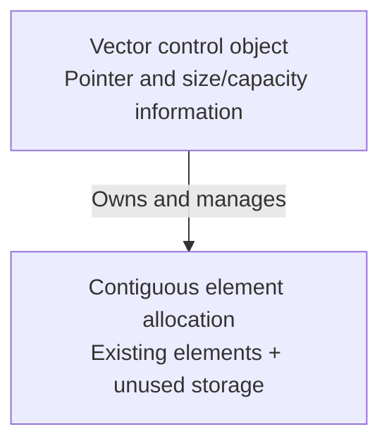
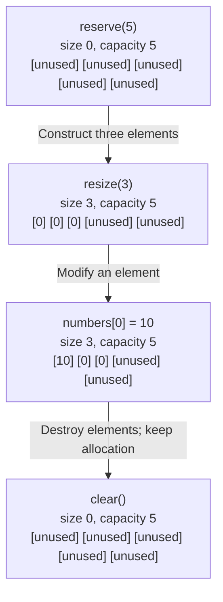
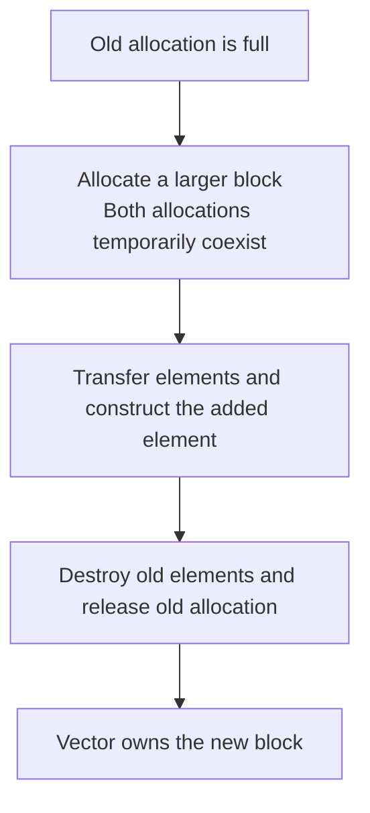

# cpp-012-vectors

## 📦 Adding and Accessing Elements

A `std::vector` stores elements contiguously and can grow. `push_back()` adds an element at the end; indexes begin at zero.

Inside `main()`, with `<vector>`, `<string>`, and `<iostream>` included:

```cpp
std::vector<std::string> meVector;
meVector.push_back("Hi");
meVector.push_back("Hi again");
meVector.push_back("baby");

std::cout << meVector[1] << '\n'; // Hi again
```

Only indexes below `size()` are valid. `operator[]` does not check bounds; `at()` checks and throws `std::out_of_range` for an invalid index.

## 💾 Size, Capacity, Reserve, and Resize

**Size** counts existing elements. **Capacity** describes how many elements fit in the current allocation before reallocation is needed.

| Method | Effect |
|---|---|
| `size()` | Returns the number of existing elements |
| `capacity()` | Returns available element capacity |
| `reserve(n)` | Requests capacity of at least `n`; preserves size |
| `resize(n)` | Adds or removes elements to make size equal `n` |
| `clear()` | Destroys all elements; retains capacity |

```cpp
std::vector<int> numbers;
numbers.reserve(5);    // size 0, capacity at least 5
numbers.resize(3);     // {0, 0, 0}
numbers.resize(5, 42); // {0, 0, 0, 42, 42}
numbers.resize(2);     // {0, 0}; capacity retained
numbers.clear();       // size 0; capacity retained
```

With the default allocator, `resize(n)` initializes added `int` elements to zero. `resize(n, value)` uses `value` only for new elements. Growing beyond capacity reallocates; shrinking size retains capacity.

> ⚠️ **Capacity does not make an index valid.**
>
> After `reserve(5)` on an empty vector, `numbers[0]` is invalid because no element exists there. Use `resize()` or `push_back()` first.

`size() <= capacity()` always holds. `reserve()` does nothing when the requested value is no greater than current capacity; it does not shrink storage.

## 🧠 What Happens in Memory?

A vector has a small control object and separately allocated element storage. A local vector's control object typically lives on the stack; with the default allocator, the element block normally comes from the heap.



The exact control fields are implementation details. A global vector has a control object with static storage duration, but still uses its allocator for elements.

For the following diagram, assume `reserve(5)` results in capacity exactly `5`; implementations may allocate more.



Each box represents room for an `int`. Unused slots are reserved storage outside the vector's existing elements. `clear()` does not promise to overwrite the old bytes with zeros.

If `sizeof(int) == 4` and capacity is exactly five:

```text
3 live elements × 4 bytes = 12 bytes occupied by elements
5 capacity slots × 4 bytes = 20 bytes of retained element storage
```

These figures exclude the control object and allocator bookkeeping.

### 🔄 Reallocation and Embedded Memory

When an insertion exceeds capacity, the vector obtains a larger contiguous block and transfers its elements. The implementation chooses the growth factor; doubling is not guaranteed.



This is a conceptual sequence; construction order can vary. On a microcontroller, consider allocation latency, finding contiguous free memory, and the temporary peak from two allocations.

> ⚠️ **Reallocation invalidates pointers, references, and iterators into the old allocation.**
>
> `clear()` also invalidates iterators to removed elements even though the allocation remains. Destroying the vector releases its element allocation through the allocator.

For `vector<string>`, only the **string objects** are contiguous. Character data may be stored inside each object or separately allocated, so `capacity() * sizeof(std::string)` does not capture all possible memory use. Reserving vector capacity does not reserve character storage inside each string.

## 👉 Iterators and `*i++`

An iterator represents a position. Dereference it with `*` to access an element; increment it to advance.

```cpp
std::vector<int> it = {1, 2, 3};
auto i = it.begin();

std::cout << *i++ << '\n'; // 1
std::cout << *i++ << '\n'; // 2
std::cout << *i++ << '\n'; // 3
```

Here, `it` names the vector and `i` is its iterator. `auto` deduces `std::vector<int>::iterator`.

`*i++` means `*(i++)`: postfix increment produces the previous position and advances `i`; dereferencing that previous position accesses the printed value.


After the third statement, `i == it.end()`. A fourth dereference would be invalid. A loop checks the stopping condition before each access:

```cpp
for (auto i = it.begin(); i != it.end(); ++i) {
    std::cout << *i << '\n';
}
```

For an empty vector, `begin() == end()`, so the loop performs no dereferences.

## 🧪 Interview Q&A

**Q1:** Does `reserve(100)` create 100 elements?

**Q2:** Does `clear()` free or zero the vector's allocation?

**Q3:** Why can `push_back()` invalidate an iterator?

> [!answer]- 📋 Answers
>
> **A1:** No. It requests storage; size is unchanged.
>
> **A2:** Neither is guaranteed by clearing elements: the allocation is retained and old bytes are not guaranteed to be zeroed. Element destructors can release resources owned by those elements.
>
> **A3:** If growth requires reallocation, the old allocation is released and its iterators become invalid.

## 🔨 Hands-On Practice

1. Reserve eight slots in an empty vector, then print size and capacity.

    ✅ Expect size zero and capacity at least eight.

2. Call `resize(3, 7)`, then `resize(1)`, then `clear()`.

    ✅ Expect `{7, 7, 7}`, then `{7}`, then no elements. Capacity remains unchanged after shrinking and clearing.

3. Use the iterator loop to visit `{1, 2, 3}` and then an empty vector.

    ✅ Expect three values in the first case and no values in the second.

### 📋 Quick Reference

| Expression | Meaning |
|---|---|
| `v.push_back(value)` | Add an element; may reallocate |
| `v[index]` / `v.at(index)` | Unchecked / checked element access |
| `v.size()` / `v.capacity()` | Existing element count / available capacity |
| `v.reserve(n)` / `v.resize(n)` | Request storage / change element count |
| `v.clear()` | Remove elements and retain capacity |
| `v.begin()` / `v.end()` | First position / position past the last element |
| `*i++` | Access previous position and advance iterator |

### 🧠 Things to Remember

- Size determines valid indexes; capacity can be larger.
- Vector elements are contiguous; growing may change their addresses.
- Removing elements ends their lifetimes without guaranteeing zeroed storage.
- Never dereference `end()`.

### 💡 Pro Tips

- Reserve a known capacity during initialization to avoid later reallocations while within that capacity. The initial allocation can still fail.
- Avoid `reserve(size() + 1)` before every insertion; it can defeat normal growth and force frequent allocations.
- Reuse a buffer with `clear()`; use `std::array<T, N>` when the element count is fixed and separate dynamic allocation is unwanted.
- Treat `shrink_to_fit()` as a non-binding request. It may reallocate and invalidate element addresses.

### 🔗 Related Topics

- [[cpp-1-exceptions]]
- [[cpp-2-files]]
