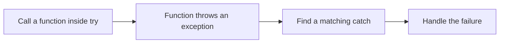
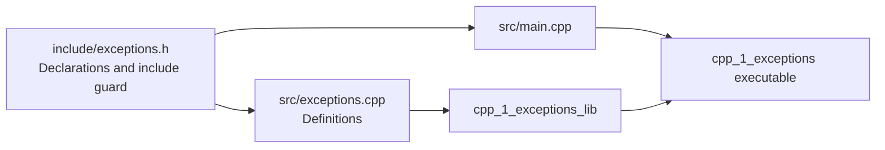

# cpp-1-exceptions

## 🚨 Throwing and Catching an Error

An exception reports a failure to a caller. `throw` transfers control to a matching `catch`; statements after the throw in the same path do not run.

The basic exercise in `examples/basic-throw.cpp` throws an integer:

```cpp
try {
    throw 10;
} catch (int error) {
    std::cout << error << '\n';
}
```

**Expected output:** `10`.



## 🧩 A Custom Exception Class

The main program calls `TestClass::sthWrong()`, which throws `myExceptions`. Inheriting from `std::exception` lets callers catch the custom type or its standard base class.

```cpp
try {
    TestClass::sthWrong();
} catch (const myExceptions& error) {
    std::cout << error.what() << '\n';
    std::cout << error.when() << '\n';
}
```

`what()` returns `"Hi what()"`; the custom `when()` method returns `"Hi when()"`. The restored main program prints only `what()`.

- 🔎 **`const myExceptions&`:** Handles the original exception without copying or slicing it. The historical main uses a non-const reference; a const reference is sufficient here.

- 🧾 **`what() const noexcept override`:** Overrides the standard error-message method, leaves the exception unchanged, and promises not to throw.

- 📌 **`static`:** Allows `TestClass::sthWrong()` without constructing a `TestClass` object.

Catch a specific exception before `std::exception` if both handlers are present; the first matching handler runs. With no matching handler, an uncaught exception terminates the program.

## 📁 Header and Source Separation

`include/exceptions.h` declares the classes. `src/exceptions.cpp` defines their methods. CMake compiles the implementation into a library and links the main executable against it.



The header guard prevents repeated declarations from the same header in one translation unit. The earlier integer-throw and inline custom-class exercises led to this final split.

## 🧪 Interview Q&A

**Q1:** Why catch a custom exception by reference?

**Q2:** Does `std::exception` provide `when()`?

**Q3:** What does `noexcept` promise?

> [!answer]- 📋 Answers
>
> **A1:** It avoids copying and preserves the original exception object's type and details.
>
> **A2:** No. `when()` belongs to this custom class; `what()` is the standard interface.
>
> **A3:** The function will not let an exception escape. If one does escape, the program calls `std::terminate()`.

## 🔨 Hands-On Practice

1. Run `exceptions_basic`, then `cpp_1_exceptions`, using the build instructions in the project README.

    ✅ Expected output is `10`, then `Hi what()`.

2. Print `when()` from the custom handler, then try catching `const std::exception&` instead.

    ✅ `what()` remains available through the base class; `when()` does not.

### 📋 Quick Reference

| Syntax | Meaning |
|---|---|
| `throw myExceptions();` | Reports an instance of the custom error |
| `try { ... }` | Encloses operations whose failures you want to handle |
| `catch (const myExceptions& e)` | Handles the custom exception by reference |
| `e.what()` | Returns a readable standard error message |
| `override` | Requires a matching virtual function in the base class |
| `noexcept` | Promises no exception escapes the function |

### 🧠 Things to Remember

- Only the first matching handler runs.
- Specific handlers belong before general handlers.
- An exception changes control flow; a returned message does not.

### 💡 Pro Tips

- Keep declarations in headers and compile definitions once to avoid duplicate definitions.
- In embedded builds, check whether exception support is enabled before choosing this error-handling approach; the host exercise assumes it is enabled.

### 🔗 Related Topics

- [[cpp-2-files]]
- [[cpp-012-vectors]]
